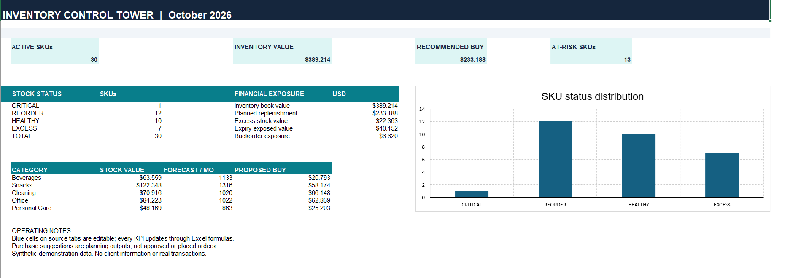

# Inventory Intelligence & Procurement Planner
## Dashboard Preview

### Advanced Excel | Inventory Analytics | Demand Forecasting | Procurement Planning

## Project Overview

Inventory Intelligence & Procurement Planner is an Excel-based decision-support solution designed to help businesses monitor inventory, analyze historical sales, forecast demand, and plan inventory replenishment.

The project demonstrates how Microsoft Excel can be used to develop an integrated operational planning model with automated calculations, procurement recommendations, management reporting, and data quality assurance.

## Key Features

- **Inventory Monitoring:** Track stock availability, incoming inventory, commitments, and potential shortages.
- **Demand Forecasting:** Analyze historical sales using three-month and six-month moving averages.
- **Automated Replenishment:** Calculate recommended purchase quantities based on projected demand, current stock, and planning parameters.
- **Supplier Constraints:** Apply minimum order quantities and packaging multiples to purchasing recommendations.
- **Inventory Risk Analysis:** Identify potential inventory shortages, excess stock, and products approaching expiration.
- **Purchase Planning:** Generate structured procurement recommendations.
- **Data Quality Assurance:** Detect missing identifiers, duplicate records, negative values, and inconsistencies in purchasing calculations.
- **Management Reporting:** Monitor operational and financial inventory indicators through an integrated Excel dashboard.

## Workbook Structure

| Worksheet | Purpose |
|---|---|
| START HERE | Project instructions and navigation |
| Dashboard | Management reporting and operational KPIs |
| SKU Master | Product master data and supplier information |
| Sales History | Historical product sales |
| Inventory | Inventory positions and stock-related information |
| Forecast & Reorder | Demand forecasting and replenishment calculations |
| Purchase Orders | Purchasing recommendations |
| Quality Checks | Data validation and model consistency |
| Assumptions | Configurable planning parameters |

## Technologies & Skills

- Microsoft Excel
- Advanced Excel formulas
- Spreadsheet modeling
- Inventory analysis
- Demand forecasting
- Procurement planning
- KPI reporting
- Data validation
- Business process automation through spreadsheet formulas

## Getting Started

1. Download `Inventory_Intelligence_Procurement_Planner_PORTFOLIO.xlsx`.
2. Open the workbook using Microsoft Excel.
3. Read the instructions in the **START HERE** worksheet.
4. Review the sample product, sales, and inventory data.
5. Adjust the configurable planning assumptions as needed.
6. Explore the forecasting calculations and procurement recommendations.
7. Review the **Quality Checks** worksheet before interpreting the results.

## Data & Methodology

This project uses synthetic business data created for demonstration and portfolio purposes. It does not contain confidential information from a real organization.

Demand estimates are based on historical sales averages and predefined planning parameters. Recommended purchase quantities are calculated using inventory positions, forecast demand, and applicable supplier purchasing constraints.

The outputs are intended to support purchasing decisions rather than automatically authorize transactions.

## Project Scope

The workbook is a demonstrative Excel planning model configured for 30 products and 12 months of sales history. It is not presented as a fully deployed enterprise resource planning system.

Core formula behavior and selected data quality scenarios have been tested. Full independent acceptance testing in Microsoft Excel Desktop is not claimed.

## Potential Business Applications

This model demonstrates an approach applicable to wholesale distribution, retail inventory management, procurement support, and small-business supply chain planning.

---

**Project type:** Independent portfolio case study  
**Data:** Synthetic demonstration dataset  
**Primary technology:** Microsoft Excel  
**Focus:** Inventory Analytics, Demand Forecasting & Procurement Planning